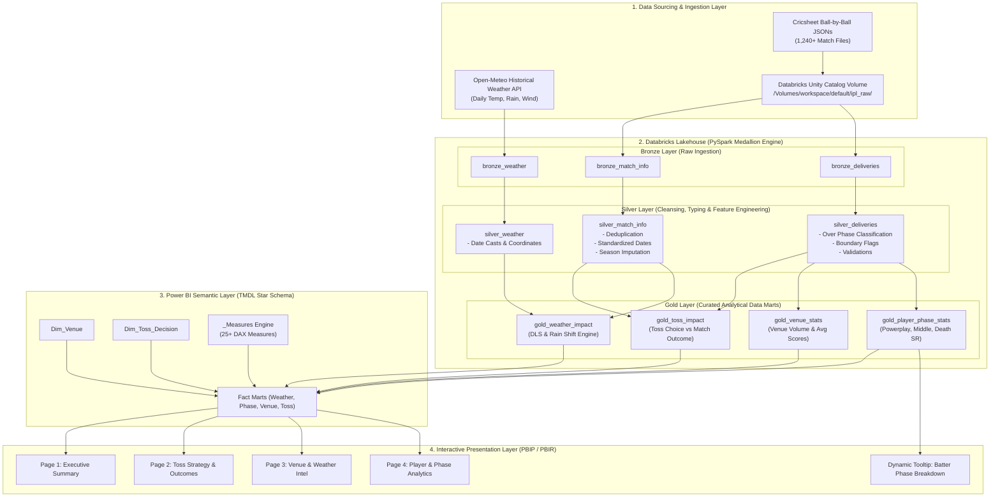
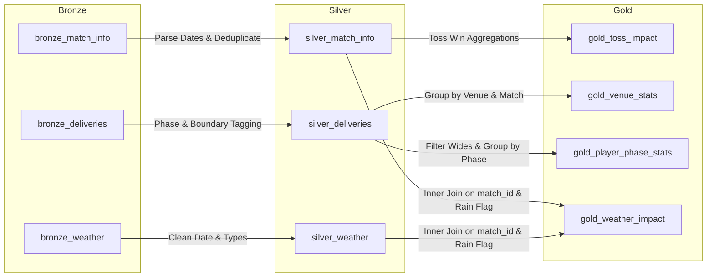
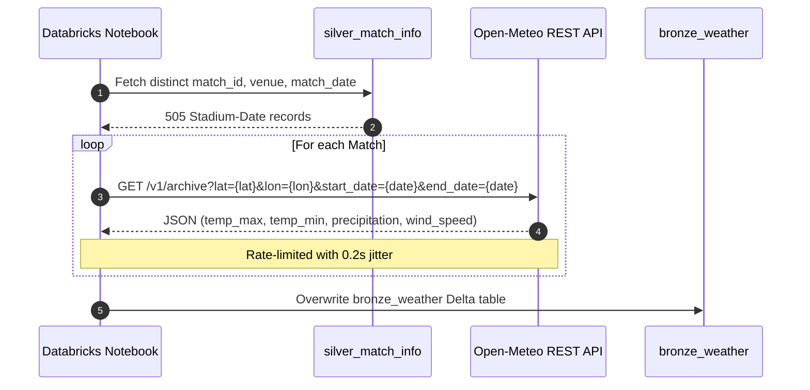
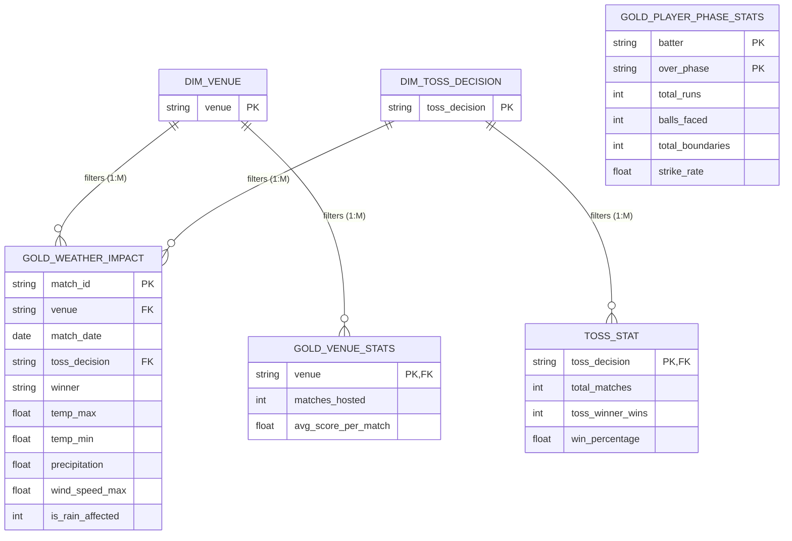
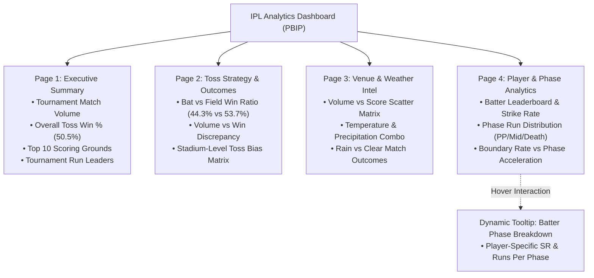

# 🏏 IPL Analytics & Big Data Lakehouse Platform
### End-to-End Cricket Intelligence: Databricks Medallion Architecture & Power BI PBIP

[](#)
[](#)
[](#)
[](#)
[-00B4D8)](#)
[-10B981)](#)

---

## 📋 Table of Contents
1. [Project Overview](#-project-overview)
2. [End-to-End System Architecture](#-end-to-end-system-architecture)
3. [Lakehouse Medallion Pipeline (Databricks & PySpark)](#-lakehouse-medallion-pipeline-databricks--pyspark)
4. [Weather API Enrichment Pipeline](#-weather-api-enrichment-pipeline)
5. [Data Modeling & Star Schema (TMDL)](#-data-modeling--star-schema-tmdl)
6. [DAX Business Measures & Analytics](#-dax-business-measures--analytics)
7. [Power BI Dashboard Pages & Visual Hierarchy](#-power-bi-dashboard-pages--visual-hierarchy)
8. [DevOps, CI/CD & PBIP Developer Workflow](#-devops-cicd--pbip-developer-workflow)
9. [Project Directory Structure](#-project-directory-structure)
10. [Setup, Execution & Validation Guide](#-setup-execution--validation-guide)
11. [PDF Conversion Guide](#-pdf-conversion-guide)

---

## 📌 Project Overview

The **IPL Big Data Analytics Platform** is an enterprise-grade sports intelligence system that processes over 1,200 matches and 200,000+ granular ball-by-ball deliveries across the history of the Indian Premier League (2008–Present). 

It unifies **Cricsheet ball-by-ball delivery telemetry** with **Open-Meteo meteorological weather data** (temperature, precipitation, and wind speeds) to evaluate the impact of environmental factors, pitch conditions, toss strategies, and match phases (Powerplay, Middle, Death) on match outcomes and player performance.

### Key Highlights
* **Big Data Lakehouse:** Built on Databricks Delta Lake using PySpark and Lakeflow Spark Declarative Pipelines.
* **Medallion Data Architecture:** Multi-hop pipeline separating Raw ingestion (`Bronze`), Cleansed/Enriched (`Silver`), and Analytical Business Marts (`Gold`).
* **Micro-Climate Weather Integration:** Automated REST ingestion querying geographical venue coordinates for historical weather metrics on every match date.
* **Modern Power BI Git Architecture:** Built entirely in Developer PBIP format using Tabular Model Definition Language (`TMDL`) and enhanced Power BI Report JSON definitions (`PBIR`), enabling version control and collaborative development.
* **Custom Dark Theme:** Modern broadcast-grade UI palette (Navy `#0B132B`, Trophy Gold `#F5B700`, Electric Cyan `#00B4D8`, Coral Red `#EF476F`).

---

## 🏗 End-to-End System Architecture



---

## ⚙ Lakehouse Medallion Pipeline (Databricks & PySpark)

The ETL pipeline is defined in [my_transformation.py](file:///c:/IPL%20Analysis%20BIG%20data%20project/my_transformation.py) using PySpark declarative pipeline decorators (`@dp.table` and `@dp.materialized_view`).



### 1. Bronze Layer (Raw Extraction)
* Extracts JSON match files directly from Unity Catalog Volumes.
* Disaggregates root attributes (`info`) into `bronze_match_info` and deeply nested delivery arrays into `bronze_deliveries`.

```python
# Sample Bronze Delivery Extraction
match_id = os.path.basename(fpath).replace(".json", "")
for inn_idx, inn in enumerate(d.get("innings", [])):
    batting_team = inn.get("team")
    for over in inn.get("overs", []):
        over_no = over.get("over")
        for ball_idx, ball in enumerate(over.get("deliveries", [])):
            runs = ball.get("runs", {})
            extras = ball.get("extras", {}) or {}
            wickets = ball.get("wickets", []) or []
            delivery_rows.append({
                "match_id": match_id,
                "innings_no": inn_idx + 1,
                "batting_team": batting_team,
                "over_no": over_no + 1,
                "ball_in_over": ball_idx + 1,
                "batter": ball.get("batter"),
                "bowler": ball.get("bowler"),
                "runs_batter": runs.get("batter", 0),
                "runs_total": runs.get("total", 0),
                "extra_wides": extras.get("wides", 0),
                "is_wicket": 1 if wickets else 0
            })
```

### 2. Silver Layer (Cleansing & Feature Engineering)
* **Standardization:** Date casting (`yyyy-MM-dd`), string trimming, deduplication by `match_id`.
* **Match Phase Segmentation:**
  $$\text{Over Phase} = \begin{cases} 
  \text{"Powerplay"}, & 1 \le \text{over\_no} \le 6 \\ 
  \text{"Middle Overs"}, & 7 \le \text{over\_no} \le 15 \\ 
  \text{"Death Overs"}, & 16 \le \text{over\_no} \le 20 
  \end{cases}$$
* **Boundary Derivation:** Binary indicator where `runs_batter IN (4, 6)`.

```python
@dp.table(name="silver_deliveries")
def silver_deliveries():
    return (
        spark.read.table("bronze_deliveries")
        .withColumn("over_phase", 
            when(col("over_no") <= 6, "Powerplay")
            .when((col("over_no") > 6) & (col("over_no") <= 15), "Middle Overs")
            .otherwise("Death Overs"))
        .withColumn("is_boundary", when(col("runs_batter").isin(4, 6), 1).otherwise(0))
        .filter(col("batter").isNotNull() & col("bowler").isNotNull())
    )
```

### 3. Gold Layer (Business Marts & Materialized Views)
* **`gold_toss_impact`:** Aggregates toss choices, toss-winner victories, and match conversion percentage.
* **`gold_venue_stats`:** Computes matches hosted, total venue scoring volume, and average score per match.
* **`gold_player_phase_stats`:** Aggregates individual batter efficiency per phase, strictly filtering legal deliveries (`extra_wides == 0`) and requiring a statistical threshold ($> 100$ balls faced).
* **`gold_weather_impact`:** Joins match data with weather telemetry, tagging rain-affected matches (`precipitation > 0.5 mm`).

---

## 🌤 Weather API Enrichment Pipeline

External weather metrics are ingested using Open-Meteo's historical API mapped against the geographical coordinates of key cricket stadiums across India and the UAE:



| Venue | Latitude | Longitude | Key Environmental Factor |
| :--- | :---: | :---: | :--- |
| **Wankhede Stadium, Mumbai** | `18.938` | `72.825` | Coastal humidity, prominent evening dew factor |
| **M. Chinnaswamy Stadium, Bengaluru** | `12.979` | `77.599` | High altitude (~920m), thin air, high boundary rate |
| **Eden Gardens, Kolkata** | `22.564` | `88.343` | High humidity, susceptibility to Nor'wester pre-monsoon rain |
| **Narendra Modi Stadium, Ahmedabad** | `23.091` | `72.597` | Extreme dry heat ($>40^\circ\text{C}$), large boundary perimeter |
| **MA Chidambaram, Chennai (Chepauk)** | `13.063` | `80.279` | High heat & humidity, dry abrasive pitch favoring spin |
| **Dubai International Cricket Stadium** | `25.047` | `55.221` | Desert dry heat, ring-of-fire lighting, dew considerations |

---

## 📊 Data Modeling & Star Schema (TMDL)

The semantic model follows a Star/Constellation Schema modeled in Tabular Model Definition Language (TMDL):



---

## 🧮 DAX Business Measures & Analytics

Over 25 production DAX measures are centralized in the `_Measures` table across 3 primary display folders:

### 1. Match & Toss Intelligence
* **Toss Conversion Advantage:**
  ```dax
  [Overall Toss Win %] = 
  DIVIDE(
      SUM('toss stat'[toss_winner_wins]), 
      SUM('toss stat'[total_matches]), 
      0
  )
  ```
* **Decision-Specific Win Conversion:**
  ```dax
  [Bat First Win %] = 
  DIVIDE(
      CALCULATE(SUM('toss stat'[toss_winner_wins]), 'toss stat'[toss_decision] = "bat"), 
      CALCULATE(SUM('toss stat'[total_matches]), 'toss stat'[toss_decision] = "bat"), 
      0
  )
  ```
  ```dax
  [Field First Win %] = 
  DIVIDE(
      CALCULATE(SUM('toss stat'[toss_winner_wins]), 'toss stat'[toss_decision] = "field"), 
      CALCULATE(SUM('toss stat'[total_matches]), 'toss stat'[toss_decision] = "field"), 
      0
  )
  ```
* **Rain-Induced Tactical Bias (DLS Chasing Shift):**
  ```dax
  [Rain vs Clear Win Shift] = 
  VAR RainFieldRate = 
      DIVIDE(
          CALCULATE(COUNTROWS('Gold weather impact'), 'Gold weather impact'[is_rain_affected] = 1, 'Gold weather impact'[toss_decision] = "field"), 
          CALCULATE(COUNTROWS('Gold weather impact'), 'Gold weather impact'[is_rain_affected] = 1), 
          0
      )
  VAR ClearFieldRate = 
      DIVIDE(
          CALCULATE(COUNTROWS('Gold weather impact'), 'Gold weather impact'[is_rain_affected] = 0, 'Gold weather impact'[toss_decision] = "field"), 
          CALCULATE(COUNTROWS('Gold weather impact'), 'Gold weather impact'[is_rain_affected] = 0), 
          0
      )
  RETURN RainFieldRate - ClearFieldRate
  ```

### 2. Batting & Match Phase Efficiency
* **Weighted True Strike Rate:**
  ```dax
  [Weighted Strike Rate] = 
  DIVIDE(
      SUM('Gold Player phase stats'[total_runs]), 
      SUM('Gold Player phase stats'[balls_faced]), 
      0
  ) * 100
  ```
* **Phase-Specific Strike Rates:**
  ```dax
  [Powerplay SR] = CALCULATE([Weighted Strike Rate], 'Gold Player phase stats'[over_phase] = "Powerplay")
  [Middle Overs SR] = CALCULATE([Weighted Strike Rate], 'Gold Player phase stats'[over_phase] = "Middle Overs")
  [Death Overs SR] = CALCULATE([Weighted Strike Rate], 'Gold Player phase stats'[over_phase] = "Death Overs")
  ```
* **Boundary Run Dependency:**
  $$\text{Boundary Run \%} = \frac{\sum (\text{total\_boundaries} \times 4)}{\sum \text{total\_runs}}$$

---

## 🖥 Power BI Dashboard Pages & Visual Hierarchy

The report contains **4 core analytical dashboards** plus a **dedicated dynamic tooltip page**:



### Detailed Page Breakdown
1. **Executive Summary (`Page1_ExecutiveSummary`):**
   * **KPIs:** Total Matches Analyzed (`505`), Overall Toss Win % (`50.5%`), Avg Match Score (`324.8`), Rain Affected Matches (`11.9%`).
   * **Charts:** Bat vs. Field Win %, Top 10 High-Scoring Venues, Rain-Affected Games by Ground, Leading Run Scorers.
2. **Toss Strategy & Outcomes (`Page2_TossStrategy`):**
   * **Core Insight:** Highlights that winning the toss offers no overall statistical advantage (~50.5%), but **decision execution** does: teams fielding first win **53.7%** of games compared to only **44.3%** when batting first.
   * **Charts:** Toss Split Donut (825 Field vs 418 Bat), Matches vs Toss Winner Wins Clustered Bar, Venue Toss Breakdown Table.
3. **Venue & Weather Intelligence (`Page3_VenueWeather`):**
   * **Core Insight:** Correlation between extreme temperatures ($>38^\circ\text{C}$ in Ahmedabad/Jaipur) and fatigue/high totals; identification of grounds prone to DLS interruptions.
   * **Charts:** Volume vs Average Score Scatter Plot (Sized by Matches Hosted), Dual-Axis Line + Column Chart for Temp & Precipitation.
4. **Player & Phase Performance (`Page4_PlayerPerformance`):**
   * **Core Insight:** Separates anchor batsmen from late-order finishers by breaking down strike rate acceleration across the 3 tactical phases.
   * **Charts:** 100% Stacked Bar of Run Share by Phase, Phase Strike Rate vs Boundaries Column Chart, Interactive Batter Leaderboard.
5. **Batter Breakdown Tooltip (`Tooltip_BatterBreakdown`):**
   * Sized at `320 x 240 px`; dynamically activates when hovering over any player in the leaderboard to display their personal Powerplay, Middle, and Death overs metrics.

---

## 🛠 DevOps, CI/CD & PBIP Developer Workflow

Unlike legacy binary `.pbix` files, this repository utilizes Microsoft Fabric's **Power BI Project (`.pbip`)** architecture:

```
IPL_Analytics_Dashboard/
├── IPL_Analytics_Dashboard.pbip             <-- Root Project Manifest
├── IPL_Analytics_Dashboard.SemanticModel/   <-- TMDL Dataset Definition
│   ├── definition.pbism                     <-- Semantic Model Metadata
│   └── definition/
│       ├── database.tmdl                    <-- Compatibility Level (1550)
│       ├── model.tmdl                       <-- Model Annotations
│       ├── relationships.tmdl               <-- Cross-Table Relationships
│       └── tables/                          <-- Isolated TMDL per Table
│           ├── _Measures.tmdl               <-- Central DAX Script
│           ├── Dim_Venue.tmdl               <-- Dimension
│           ├── Dim_Toss_Decision.tmdl       <-- Dimension
│           ├── Gold weather impact.tmdl     <-- Fact
│           └── Gold Player phase stats.tmdl <-- Fact
└── IPL_Analytics_Dashboard.Report/          <-- PBIR Modular Report Format
    ├── definition.pbir                      <-- Dataset Binding Pointer
    ├── definition/
    │   ├── report.json                      <-- Theme & Filter Canvas Config
    │   └── pages/                           <-- Discrete Page Folders
    │       ├── Page1_ExecutiveSummary/visuals/
    │       ├── Page2_TossStrategy/visuals/
    │       ├── Page3_VenueWeather/visuals/
    │       ├── Page4_PlayerPerformance/visuals/
    │       └── Tooltip_BatterBreakdown/visuals/
    └── StaticResources/RegisteredResources/IPL_Dark_Analytics.json
```

### Advantages of PBIP & TMDL
* **Source Control Friendly:** Every table, visual, and measure is isolated into human-readable text files, enabling clean `git diff`, pull request code reviews, and multi-developer branching without merge conflicts.
* **Automated CI/CD Validation:** Automated Python scripts ([preflight_check.py](file:///c:/IPL%20Analysis%20BIG%20data%20project/preflight_check.py) and [validate_final.py](file:///c:/IPL%20Analysis%20BIG%20data%20project/validate_final.py)) run syntax and reference integrity checks on all JSON/TMDL schemas before deployment.

---

## 📁 Project Directory Structure

```
c:\IPL Analysis BIG data project
│
├── 📜 my_transformation.py                 # Databricks PySpark Declarative Pipeline (Medallion ETL)
├── 📜 weather_api_ingestion.html           # Exported Databricks Open-Meteo REST API Ingestion Notebook
├── 📜 Golden stats downloads.ipynb         # Databricks Gold Marts Export & Pre-processing Notebook
│
├── 📊 IPL_Analytics_Dashboard.pbip          # Power BI Project Master File
├── 📊 IPL_Analytics_Dashboard.pbix          # Compiled Desktop Binary (169 KB)
├── 🎨 IPL_Dark_Analytics.json              # Custom Dark Theme Definition
│
├── 📂 IPL_Analytics_Dashboard.SemanticModel/ # TMDL Data Model Definition
│   ├── definition.pbism
│   └── definition/ (database, model, relationships, tables/*.tmdl)
│
├── 📂 IPL_Analytics_Dashboard.Report/        # PBIR Visual Containers & Pages
│   ├── definition.pbir
│   └── definition/pages/ (4 Dashboard Pages + 1 Tooltip, 45 Visual JSONs)
│
├── 📁 Gold Data Extracts (CSV Marts):
│   ├── 📄 Gold weather impact.csv          # 505 Matches with Environmental Metrics
│   ├── 📄 gold venue stats.csv             # 42 Venues with Average Scoring Rates
│   ├── 📄 Gold Player phase stats.csv      # Phase-wise Batting Telemetry
│   └── 📄 toss stat.csv                    # Aggregate Toss Decision Conversions
│
├── 🛠 Developer & Validation Scripts:
│   ├── 🐍 build_pbir_project.py            # Automated PBIR Project Scaffolder
│   ├── 🐍 build_semantic_model.py          # TMDL Extractor & Builder
│   ├── 🐍 generate_full_report_json.py     # Programmatic Visual Builder
│   ├── 🐍 preflight_check.py               # Pre-flight Semantic & Visual JSON Validator
│   └── 🐍 validate_final.py                # Final Model & Schema Verification
│
└── 📦 ipl_male_json.zip                    # Raw Cricsheet Ball-by-Ball JSON Archive
```

---

## 🚀 Setup, Execution & Validation Guide

### Prerequisites
1. **Databricks Compute / Local Spark:**
   * Apache Spark 3.5+, Python 3.10+, PySpark, Delta Lake.
2. **Microsoft Power BI:**
   * Power BI Desktop (March 2024 Release or newer for PBIP/PBIR support).
   * Feature switch enabled: `File > Options and settings > Options > Preview features > Store semantic model using TMDL format` and `Power BI Project (.pbip) save option`.

### Step 1: Run the Databricks Medallion Pipeline
1. Upload `ipl_male_json.zip` to your Databricks Volume:
   ```bash
   databricks fs cp ipl_male_json.zip dbfs:/Volumes/workspace/default/ipl_raw/
   ```
2. Execute the weather ingestion notebook to fetch historical conditions from Open-Meteo.
3. Deploy and trigger `my_transformation.py` as a Databricks Lakeflow Pipeline.

### Step 2: Validate the Semantic Model & PBIR Files
Run the built-in preflight test suite from PowerShell:
```powershell
python preflight_check.py
python validate_final.py
```
*Expected Output:*
```
=== PRE-FLIGHT VERIFICATION ===
[OK] IPL_Analytics_Dashboard.pbip is valid JSON
[OK] definition.pbism is valid JSON
[OK] definition.pbir is valid JSON
[OK] report.json is valid JSON
[OK] pages.json is valid JSON
     - Page1_ExecutiveSummary: 11 visuals verified
     - Page2_TossStrategy: 9 visuals verified
     - Page3_VenueWeather: 10 visuals verified
     - Page4_PlayerPerformance: 11 visuals verified
     - Tooltip_BatterBreakdown: 4 visuals verified
[OK] Total visuals verified across all pages: 45
[OK] 9 TMDL files present in SemanticModel/definition
```

### Step 3: Open and Interact with the Dashboard
Double-click `IPL_Analytics_Dashboard.pbip` to open the report directly in Power BI Desktop.

---

## 🖨 PDF Conversion Guide

This `README.md` is formatted with clean typography, page breaks, and standard Mermaid diagrams to convert into a publication-quality PDF report.

### Method 1: Using VS Code Markdown PDF (Recommended)
1. Install the **Markdown PDF** extension in Visual Studio Code (`yzane.markdown-pdf`).
2. Open this `README.md`.
3. Press `Ctrl + Shift + P` and run: **`Markdown PDF: Export (pdf)`**.
4. The generated PDF will automatically render headers, tables, code blocks, and Mermaid diagrams.

### Method 2: Using Pandoc & wkhtmltopdf
```bash
pandoc README.md -o IPL_Analytics_Architecture.pdf \
  --pdf-engine=wkhtmltopdf \
  --toc \
  --toc-depth=3 \
  --highlight-style=espresso
```

### Method 3: Browser Print to PDF
1. Open this file on GitHub or preview it in any browser (e.g., using GitHub preview or Grip: `grip 6419`).
2. Press `Ctrl + P` (Print).
3. Set destination to **Save as PDF**, paper size to **A4**, and enable **Background graphics**.

---

### 👨‍💻 Authors & Acknowledgments
* **Data Sources:** [Cricsheet.org](https://cricsheet.org/) (Ball-by-Ball Cricket Data) & [Open-Meteo](https://open-meteo.com/) (Historical Weather API).
* **Architecture:** Enterprise Medallion Lakehouse & Modern BI PBIP Architecture.
